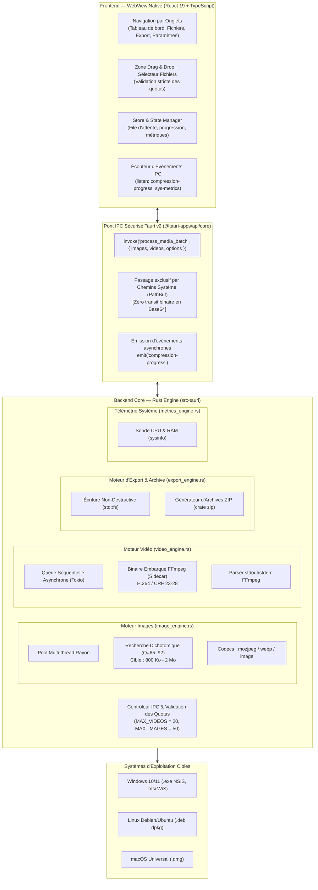
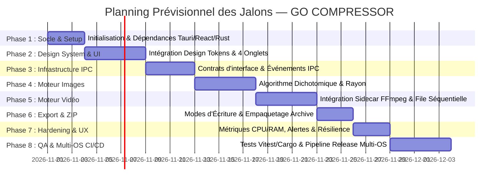

# ROADMAP DE DÉVELOPPEMENT — GO COMPRESSOR (OptiMedia Desktop)

> **Application Desktop Cross-Platform d'Optimisation et de Compression Multimédia par Lots**  
> **Version cible :** v1.1 — Production Ready  
> **Technologies :** Tauri v2 · React.js 19 (TypeScript) · Rust 2024 · FFmpeg (Sidecar)  
> **Systèmes cibles :** Windows 10/11 (`.exe` NSIS, `.msi` WiX) · Linux Debian/Ubuntu (`.deb`) · macOS (`.dmg` Universal)

---

## 1. Vision du Produit & Objectifs Stratégiques

**GO COMPRESSOR** est un utilitaire de bureau moderne, ultra-rapide et respectueux des ressources matérielles, conçu pour compresser et optimiser massivement des fichiers multimédias sans compromis sur la qualité visuelle.

### 1.1 Objectifs Clés
1. **Haute Performance Native :** Déléguer 100 % des calculs lourds à un backend Rust compilé et multithreadé (`rayon`), évitant l'empreinte mémoire d'Electron.
2. **Zéro Saturation Matérielle :** 
   - Parallélisation CPU optimisée pour les images (jusqu'à 50 photos de ~15 Mo par lot).
   - File séquentielle asynchrone stricte pour la vidéo plafonnée à **20 fichiers maximum** afin d'empêcher les hausses brutales de RAM ou de température CPU.
3. **Calibrage Précis au Poids Cible :** Moteur d'images adaptatif basé sur une **recherche dichotomique** de qualité ($Q \in [65, 92]$) garantissant une sortie entre **800 Ko et 2 Mo** (soit 85 % à 95 % de réduction).
4. **Zéro Écrasement Destructif :** Préservation intégrale des originaux, options d'export flexibles (dossier dédié, suffixe `_opt`, sous-dossier horodaté) et empaquetage d'archive `.zip` en un clic.
5. **Ergonomie Desktop & Retours Temps Réel :** Interface intuitive à 4 onglets issue du prototype interactif officiel, jauge de progression IPC continue et indicateurs télémétriques CPU/RAM.

---

## 2. Architecture Globale du Système

### 2.1 Diagramme d'Architecture Modulaire



### 2.2 Règles Architecturales Fondamentales (Standards Senior Developer)
- **Règle Zéro Base64 (CDC §04) :** Aucun fichier média ne transite dans le bridge JSON IPC sous forme de chaîne base64 ou tableau d'octets. Seuls les chemins absolus (`PathBuf`) validés sont échangés.
- **Principe de Responsabilité Unique (SRP) :**
  - `image_engine.rs` : Ne gère que l'analyse et la compression par lots d'images.
  - `video_engine.rs` : Ne gère que le cycle de vie du processus FFmpeg et la file d'attente vidéo.
  - `export_engine.rs` : Ne gère que la persistance des fichiers compressés et l'empaquetage `.zip`.
  - `metrics_engine.rs` : Fournit les métriques machine (usage CPU, occupation mémoire).
- **Zéro Panique en Rust :** Utilisation systématique de `Result<T, CustomError>` avec typage d'erreurs explicite (`thiserror`) et transformation propre en messages d'erreur contextualisés vers le frontend.
- **Fidélité Totale au Prototype :** Réplication stricte des classes, styles, tokens CSS (`bundle.css`), icônes vectorielles SVG et micro-interactions issues du prototype interactif (`reference/GO COMPRESSOR — Prototype interactif-html`).

---

## 3. Découpage Opérationnel par Phases de Développement



---

### Phase 1 : Socle Technique, Outillage & Dépendances
*Objectif : Mettre en place un environnement robuste, typé et testable dès le premier commit.*

- [x] **1.1 Configuration du projet Tauri v2 :**
  - Mettre à jour `src-tauri/tauri.conf.json` avec l'identifiant officiel (`com.blackcode.gocompressor`), le titre de fenêtre (`GO COMPRESSOR`), les dimensions par défaut ($1180 \times 820$, min $960 \times 680$).
  - Activer la configuration des cibles de packaging : `"targets": ["nsis", "msi", "deb", "dmg"]`.
  - Configurer les permissions Tauri v2 dans `src-tauri/capabilities/default.json` pour autoriser :
    - Boîtes de dialogue système (`dialog:default`, `dialog:allow-open`, `dialog:allow-save`).
    - Accès au système de fichiers (`fs:default`, lecture et écriture des répertoires d'export).
    - Ouverture d'URL/dossiers (`opener:default`).
- [x] **1.2 Dépendances Rust (`src-tauri/Cargo.toml`) :**
  - Ajouter `rayon` (parallélisme data-parallel CPU).
  - Ajouter `image` (décodage et manipulation d'images).
  - Ajouter `mozjpeg` et `webp` (encodeurs haute fidélité).
  - Ajouter `tokio = { version = "1", features = ["full"] }` (runtime asynchrone).
  - Ajouter `zip` (génération d'archives compressées).
  - Ajouter `sysinfo` (sonde d'activité CPU et mémoire RAM).
  - Ajouter `thiserror` et `serde_json` (gestion d'erreurs et sérialisation).
- [x] **1.3 Dépendances Frontend (`package.json`) :**
  - Installer `@tauri-apps/plugin-dialog` et `@tauri-apps/plugin-fs`.
  - Installer `lucide-react` (si nécessaire pour compléter les glyphes vectoriels SVG natifs).
  - Configurer l'environnement de test : `vitest`, `@testing-library/react`, `@testing-library/jest-dom`, `jsdom`.
- [x] **1.4 Vérification Initiale de Pipeline :**
  - Vérifier que `cargo check` compile sans warning.
  - Vérifier que `npm run build` passe avec TypeScript en mode strict (`noImplicitAny`, `strictNullChecks`).

---

### Phase 2 : Design System & Interface Utilisateur (Reproduction Fidèle du Prototype)
*Objectif : Transposer les composants du prototype interactif HTML/CSS en composants React modulaires et accessibles.*

- [x] **2.1 Intégration des Design Tokens & Thème :**
  - Créer `src/styles/theme.css` en reprenant l'intégralité des variables CSS du prototype :
    - Couleurs surfaces : `--surface-100: #ffffff`, `--surface-200: #eef2f8`, `--tint-50: #d5eefe`, etc.
    - Accents & Marques : `--sky-500: #37a7e7`, `--azure-500: #2d9ff8`, `--cyan-400: #3cc9fe`, `--brand-text: #0b6fa8`.
    - Typographies : Font sans-serif système + Montserrat pour les titrages.
    - Rayons de courbure : `--radius-sm: 8px` jusqu'à `--radius-pill: 9999px`.
- [x] **2.2 Composants UI Atomiques Réutilisables (`src/components/common/`) :**
  - `Button.tsx` : Bouton principal avec gradient cyan/azur, variante secondaire blanche avec bordure, état désactivé, focus-ring accessible.
  - `Badge.tsx` : Badge d'information (`gc-badge`) avec fond azur clair.
  - `RangeSlider.tsx` : Curseur personnalisé avec piste dégradée dynamique (`gc-range`).
  - `ProgressBar.tsx` : Barre de progression horizontale (`gc-progress`) avec transition fluide et variante de succès verte.
  - `Dropzone.tsx` : Zone bleue drag-and-drop avec bordure intérieure en pointillés blancs (`gc-drop`).
  - `ModalAlert.tsx` : Boîte de dialogue bloquante (`role="alertdialog"`) pour les avertissements de dépassement de quota.
  - `Icons.tsx` : Glyphes vectoriels SVG intégrés et optimisés.
- [x] **2.3 Structure de Navigation Épurée (`src/components/layout/`) :**
  - `HeaderTabs.tsx` : Navigation supérieure recentrée sur 2 onglets essentiels :
    1. *Tableau de bord* (espace de traitement complet avec sous-onglets médias, sélection de destination et export/téléchargement ZIP direct).
    2. *Paramètres* (réglages fins des moteurs Rust, codecs et modes d'écriture).
- [x] **2.4 Vues Complètes & Sous-Onglets Médias :**
  - `DashboardView.tsx` :
    - Sous-onglets dédiés : *Photos & Images* (quota 50 max, JPG/PNG/WebP, calibration cible 800 Ko – 2 Mo) et *Vidéos* (quota 20 max, MP4/MOV/MKV, transcodage séquentiel anti-surcharge).
    - Zones Dropzone distinctes et adaptées pour chaque type de média.
    - Sélection du dossier de destination direct avec bouton *Parcourir…*.
    - Rapport KPI post-compression (fichiers traités, gain moyen %, poids économisé).
    - Bouton d'export et de téléchargement du lot compressé (.ZIP).
    - Barre d'action inférieure avec télémétrie CPU % et RAM Go.
  - `SettingsView.tsx` : Sliders Qmin/Qmax/Threads, banc de test interactif avec simulation de dichotomie pas à pas, slider CRF FFmpeg, sélecteur de mode d'écriture (copie, suffixe `_opt`, sous-dossier horodaté) et case à cocher EXIF.
  - `App.tsx` : Orchestration globale avec gestion d'état complète.

---

### Phase 3 : Infrastructure IPC & Gestion d'État Frontend
*Objectif : Créer une architecture réactive, typée et sécurisée entre React et Rust.*

- [x] **3.1 Typages TypeScript Miroir (`src/types/ipc.ts`) :**
  - Interface `MediaItem` : ID unique, chemin absolu système (`path`), nom, taille originale en octets, type MIME/extension, statut (`idle`, `wait`, `running`, `done`, `error`), progression (0 à 100), taille finale en octets.
  - Interface `BatchConfig` :
    - `target_min_bytes: number` (800 Ko = 819 200 octets).
    - `target_max_bytes: number` (2 Mo = 2 097 152 octets).
    - `target_bytes: number` (valeur choisie via le slider, ex: 1 104 Ko).
    - `q_min: number` (65) / `q_max: number` (92).
    - `threads: number` (1 à 8).
    - `crf: number` (23 à 28).
    - `preserve_exif: boolean`.
    - `export_mode: 'copy' | 'suffix' | 'folder'`.
    - `output_directory: string`.
  - Interface `CompressionProgressPayload` : `file_path: string`, `progress_percent: number`, `stage: string`, `current_bytes: number`, `is_done: boolean`.
- [x] **3.2 Store Global / Hook d'État (`src/hooks/useMediaBatch.ts`) :**
  - Gestion centralisée et réactive des listes d'images et de vidéos.
  - Application immédiate des **gardes-fous de quota côté UI** :
    - Blocage immédiat avec alerte modale si $> 50$ photos.
    - Blocage immédiat avec alerte modale si $> 20$ vidéos (CDC US-02).
  - Écoute active de l'événement IPC Tauri `compression-progress` pour animer les barres en direct.
  - Polling télémétrique système via la commande `get_system_metrics`.
- [x] **3.3 Intégration Native des Boîtes de Dialogue & Commandes IPC :**
  - Intégration de `@tauri-apps/plugin-dialog` :
    - `open({ multiple: true, filters: [...] })` selon l'onglet actif (photos ou vidéos).
    - `open({ directory: true })` pour le choix du répertoire de sortie.
    - `save({ filters: [{ name: 'Archive ZIP', extensions: ['zip'] }] })` pour le téléchargement du lot compressé.
  - Implémentation côté Rust (`src-tauri/src/lib.rs`) des commandes :
    - `process_media_batch(images, videos, config) -> Result<BatchReport, String>` avec rejet strict si $> 20$ vidéos ou $> 50$ photos.
    - `get_system_metrics() -> Result<SystemMetrics, String>` avec état géré thread-safe.
    - `create_zip_archive(files, destination) -> Result<u64, String>`.

---

### Phase 4 : Moteur de Compression d'Images Rust (`image_engine.rs`)
*Objectif : Traiter en parallèle les images lourdes (~15 Mo) pour les calibrer avec précision dans la fourchette 800 Ko – 2 Mo.*

- [x] **4.1 Algorithme de Recherche Dichotomique (Qualité $Q$) :**
  - Définir les constantes absolues :
    - `TARGET_MIN_BYTES: u64 = 800 * 1024` (819 200 octets).
    - `TARGET_MAX_BYTES: u64 = 2 * 1024 * 1024` (2 097 152 octets).
  - Implémenter la fonction de recherche dichotomique :
    - Intervalle initial : $[Q_{\min} = 65, Q_{\max} = 92]$.
    - Pour chaque itération, estimer ou compresser en buffer mémoire, évaluer le poids obtenu :
      - Si le poids $> \text{target\_bytes}$, alors $Q_{\max} \leftarrow Q_{\text{mid}} - 1$.
      - Si le poids $< \text{target\_bytes}$, alors $Q_{\min} \leftarrow Q_{\text{mid}} + 1$.
      - Arrêt dès convergence ou quand le poids est compris dans l'intervalle cible.
- [x] **4.2 Redimensionnement Adaptatif :**
  - Si l'image source dépasse $4K$ / $8K$ et ne peut pas atteindre $< 2\text{ Mo}$ même à $Q=65$, appliquer un ratio de sous-échantillonnage bilinéaire/Lanczos intelligent pour ramener la résolution à un standard haute définition tout en restant imperceptible à l'œil nu.
- [x] **4.3 Parallélisation Multi-Cœur avec `rayon` :**
  - Traitement du vecteur de fichiers d'images via `images.par_iter().map(...)`.
  - Notification en continu au frontend via `app_handle.emit("compression-progress", ...)` à la fin de chaque sous-étape de compression.
- [x] **4.4 Préservation des Métadonnées EXIF :**
  - Si `preserve_exif == true`, extraction des en-têtes EXIF de l'image source (orientation, modèle d'appareil, date de prise de vue) et réinjection dans le conteneur final (JPEG/WebP).

---

### Phase 5 : Moteur de Transcodage Vidéo Rust & Sidecar FFmpeg (`video_engine.rs`)
*Objectif : Transcoder les vidéos par lots de 20 maximum de manière séquentielle, asynchrone et non-bloquante.*

- [x] **5.1 Packaging du Sidecar FFmpeg :**
  - Intégrer les exécutables `ffmpeg` compilés statiquement selon la nomenclature officielle Tauri v2 :
    - `src-tauri/binaries/ffmpeg-x86_64-pc-windows-msvc.exe`
    - `src-tauri/binaries/ffmpeg-x86_64-unknown-linux-gnu`
    - `src-tauri/binaries/ffmpeg-x86_64-apple-darwin`
    - `src-tauri/binaries/ffmpeg-aarch64-apple-darwin`
  - Déclarer le binaire sidecar dans `tauri.conf.json` sous la clé `bundle.externalBin`.
- [x] **5.2 Garde-Fou Strict Côté Rust (Règle Métier CDC) :**
  - Implémenter dans la commande Rust :
    ```rust
    const MAX_VIDEOS: usize = 20;
    if videos.len() > MAX_VIDEOS {
        return Err("Limite dépassée : 20 vidéos maximum par lot.".into());
    }
    ```
- [x] **5.3 File d'Attente Séquentielle Asynchrone (Tokio) :**
  - Interdire formellement le transcodage vidéo parallèle pour préserver les ressources machine.
  - Traiter les vidéos **une par une** via un channel `tokio::sync::mpsc`.
- [x] **5.4 Lancement du Processus & Parsing Temps Réel :**
  - Exécuter la commande FFmpeg via `tokio::process::Command` avec les paramètres d'optimisation :
    `-i [input] -c:v libx264 -crf [crf:23-28] -preset medium -c:a aac -b:a 128k -movflags +faststart [output]`.
  - Parser le flux machine de FFmpeg (`-progress pipe:1`) pour calculer précisément le pourcentage d'avancement ($0\%$ à $100\%$) via `out_time_us` / `duration_us` et émettre l'événement IPC vers l'interface.
  - Écriture atomique sécurisée (`_temp_part.mp4` renommé vers la destination définitive) avec nettoyage automatique en cas d'erreur.

---

### Phase 6 : Moteurs d'Export, Archivage ZIP & Gestion des Paramètres (`export_engine.rs`)
*Objectif : Assurer la restitution intègre, sécurisée et flexible des fichiers traités.*

- [ ] **6.1 Stratégies d'Écriture Non-Destructive :**
  - **Mode Copie :** Écriture directe des médias optimisés dans le répertoire cible sélectionné par l'utilisateur.
  - **Mode Suffixe :** Sauvegarde dans le même dossier que l'original en ajoutant le suffixe `_opt` (ex: `photo_01_opt.jpg`).
  - **Mode Sous-Dossier Horodaté :** Création automatique d'un sous-dossier `Export_YYYY-MM-DD_HHmmss` pour ranger le lot sans risque de collision.
- [ ] **6.2 Module d'Empaquetage d'Archive `.zip` (CDC US-05) :**
  - Crate `zip` de Rust : création d'une archive compressée contenant tous les fichiers du lot traité.
  - Déclenchement au clic sur le bouton « Télécharger » : ouverture du dialogue de sauvegarde natif (`@tauri-apps/plugin-dialog` en mode `save` avec filtre `.zip`) pour choisir le nom et l'emplacement de l'archive.
  - Écriture en flux direct sans saturer la RAM.
- [ ] **6.3 Persistance des Préférences Utilisateur :**
  - Mémorisation locale (via `tauri-plugin-store` ou `localStorage`) des réglages utilisateur : dernier répertoire utilisé, valeur cible du slider, mode d'export préféré, conservation de l'EXIF.

---

### Phase 7 : Métriques Système Temps Réel, Alertes & Résilience
*Objectif : Garantir une expérience utilisateur transparente, informative et robuste aux imprévus.*

- [ ] **7.1 Sonde Télémétrique d'Activité Machine (`metrics_engine.rs`) :**
  - Utilisation de la crate `sysinfo` pour relever périodiquement (toutes les secondes pendant la compression) :
    - Le taux d'utilisation globale du processeur (CPU %).
    - L'occupation de la mémoire vive (RAM Go).
  - Émission au frontend pour mettre à jour l'indicateur textuel : `CPU : XX% • RAM : X.X Go`.
- [ ] **7.2 Modales d'Alerte Bloquantes & Accessibilité :**
  - Implémentation complète de la boîte modale (`gc-overlay`) accessible selon la norme WAI-ARIA :
    - Focus trap actif sur le bouton de fermeture « Compris ».
    - Fermeture possible via la touche `Échap`.
    - Lecteur d'écran informé via `role="alertdialog"`, `aria-labelledby="alert-title"` et `aria-describedby="alert-body"`.
- [ ] **7.3 Gestion des Erreurs et Robustesse (100 Règles de Code Pro) :**
  - Gestion des fichiers corrompus, permissions disque refusées, espace disque insuffisant.
  - Retour d'erreurs claires au niveau de chaque ligne de fichier dans l'onglet *Fichiers* et dans le *Rapport de compression*.

---

### Phase 8 : Recette Globale, Tests Automatisés & Pipeline CI/CD Multi-OS
*Objectif : Valider 100 % des exigences du CDC et automatiser la publication des installateurs finaux.*

- [ ] **8.1 Tests Automatisés Côté Frontend (Vitest & Testing Library) :**
  - Tests unitaires des utilitaires de formatage (`fmt(mo)`, calcul de gain en %).
  - Tests de validation des quotas : blocage de l'ajout de la $21^{\text{e}}$ vidéo et de la $51^{\text{e}}$ photo.
  - Tests de rendu des onglets et interactions du formulaire des paramètres.
- [ ] **8.2 Tests Automatisés Côté Backend Rust (`cargo test`) :**
  - Test unitaire de la recherche dichotomique sur une mire de test (vérification de la convergence vers $800\text{ Ko} - 2\text{ Mo}$).
  - Test de vérification du rejet immédiat si `videos.len() > 20`.
  - Test d'intégrité de la génération de l'archive `.zip`.
- [ ] **8.3 Qualité et Linting Stricts :**
  - Rust : `cargo clippy --all-targets -- -D warnings` (zéro warning toléré).
  - React/TS : `npm run lint` et `tsc --noEmit`.
- [ ] **8.4 Configuration de la Matrice CI/CD GitHub Actions (`.github/workflows/release.yml`) :**
  - Mise en place du workflow officiel avec 3 runners natifs :
    - `windows-latest` : génère l'installateur `.exe` (NSIS avec bootstrapper silencieux WebView2) et le paquet `.msi` (WiX Toolset).
    - `ubuntu-22.04` : installe les dépendances système GTK/WebKit et génère le paquet `.deb`.
    - `macos-latest` : compile pour Apple Silicon (`aarch64`) et Intel (`x86_64`) et génère l'image `.dmg` universelle.
  - Déclenchement automatique à la création de tout tag Git respectant le motif `v*`.

---

## 4. Matrice des Récits Utilisateurs & Critères d'Acceptation (DoD)

| Récit Utilisateur (User Story) | Priorité | Risque | Critères d'Acceptation Formels (Definition of Done) |
| :--- | :---: | :---: | :--- |
| **US-01 : Import & Gestion par Lots** | **P0** | Faible | - Dropzone fonctionnelle au glisser-déposer et sélecteur de fichiers natif.<br>- Quota d'images limité à 50 (alerte affichée si dépassé).<br>- Les chemins système absolus sont transmis sans conversion base64. |
| **US-02 : Compression Photos (800 Ko – 2 Mo)** | **P0** | Moyen | - Support des formats `JPG`, `PNG`, `WebP`.<br>- Algorithme dichotomique ajustant $Q \in [65, 92]$.<br>- $100\%$ des images en sortie respectent le gabarit $800\text{ Ko} - 2\text{ Mo}$ avec réduction de $85\%$ à $95\%$.<br>- Parallélisation multi-cœur via `rayon`. |
| **US-03 : Garde-Fou & Transcodage Vidéo** | **P0** | Élevé | - Quota vidéo strictement bridé à 20 fichiers maximum (blocage UI et rejet backend).<br>- Traitement en file d'attente strictement séquentielle (une vidéo à la fois).<br>- Encodage asynchrone FFmpeg avec CRF configurable (23-28).<br>- Aucun plantage mémoire ni emballement thermique. |
| **US-04 : Suivi & Progression Temps Réel** | **P0** | Faible | - Barres de progression individuelles animées de $0\%$ à $100\%$ via événements IPC.<br>- Indicateurs dynamiques de charge CPU (%) et RAM (Go).<br>- Boutons de pause et d'annulation réactifs. |
| **US-05 : Export Non-Destructif & Archive ZIP** | **P1** | Faible | - Fichiers originaux préservés sans aucune altération.<br>- Support des 3 modes d'écriture (dossier, suffixe `_opt`, sous-dossier daté).<br>- Génération d'une archive `.zip` téléchargeable via boîte de dialogue native. |
| **US-06 : Paramétrage Avancé du Moteur** | **P1** | Faible | - Sliders fonctionnels pour $Q_{\min}$, $Q_{\max}$, threads et CRF.<br>- Banc de simulation interactif de la recherche dichotomique.<br>- Bouton de rétablissement des valeurs d'usine par défaut. |
| **US-07 : Distribution Multi-OS Industrielle** | **P0** | Moyen | - 4 installateurs générés automatiquement par la CI (`.exe`, `.msi`, `.deb`, `.dmg`).<br>- Installation propre et démarrage fonctionnel sur OS vierges. |

---

## 5. Gestion des Risques & Stratégies d'Atténuation

| Risque Identifié | Impact | Probabilité | Stratégie d'Atténuation Prévue |
| :--- | :---: | :---: | :--- |
| **Embarquement & Cross-compilation du binaire FFmpeg** | Élevé | Moyenne | Utiliser des builds statiques de FFmpeg pré-compilés et validés pour chaque triplet cible (`x86_64-pc-windows-msvc`, `x86_64-unknown-linux-gnu`, `apple-darwin`). Les stocker dans `src-tauri/binaries/` avec la nomenclature de sidecar Tauri. |
| **Saturation Mémoire / OOM sur gros volumes d'images** | Élevé | Faible | Les images ne transitent jamais en mémoire dans le pont IPC. Côté Rust, le traitement dans `rayon` procède image par image par thread, libérant immédiatement la mémoire tampon après écriture. |
| **Différences de rendu de la WebView selon l'OS** | Moyen | Moyenne | Tester sous WebView2 (Windows), WebKitGTK (Linux) et WebKit (macOS). Utiliser un CSS standardisé sans propriétés expérimentales non supportées. |
| **Absence de WebView2 sur d'anciens postes Windows** | Élevé | Faible | Configuration du bootstrapper NSIS dans `tauri.conf.json` pour télécharger et installer silencieusement le runtime WebView2 si manquant. |

---

## 6. Définition de Terminé Générale (DoD du Projet)

Avant tout déploiement ou livraison d'une version de jalon :
1. **Zéro Erreur au Linting :** `cargo clippy --all-targets -- -D warnings` et `npm run lint` sans avertissement.
2. **Tests au Vert :** 100 % des tests unitaires et d'intégration réussis sous Vitest et Cargo.
3. **Validation Métier des Quotas :** Rejet systématique de la $21^{\text{e}}$ vidéo et de la $51^{\text{e}}$ photo.
4. **Validation Métier des Images :** Vérification sur un lot témoin de 15 Mo que les fichiers finaux pèsent entre 800 Ko et 2 Mo.
5. **Intégrité des Données :** Aucun fichier source écrasé ou altéré par erreur.
6. **Documentation & Changelog :** README et documentation de version scrupuleusement synchronisés avec l'état réel du code.
